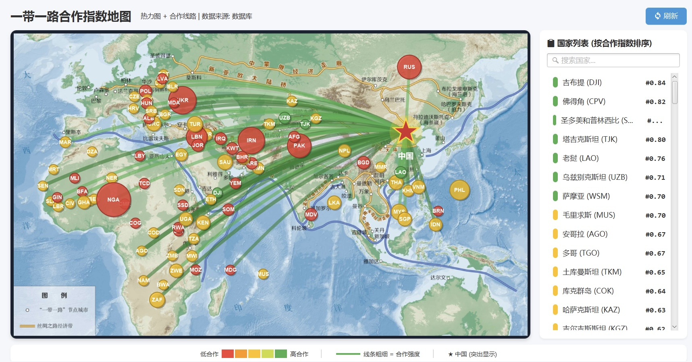
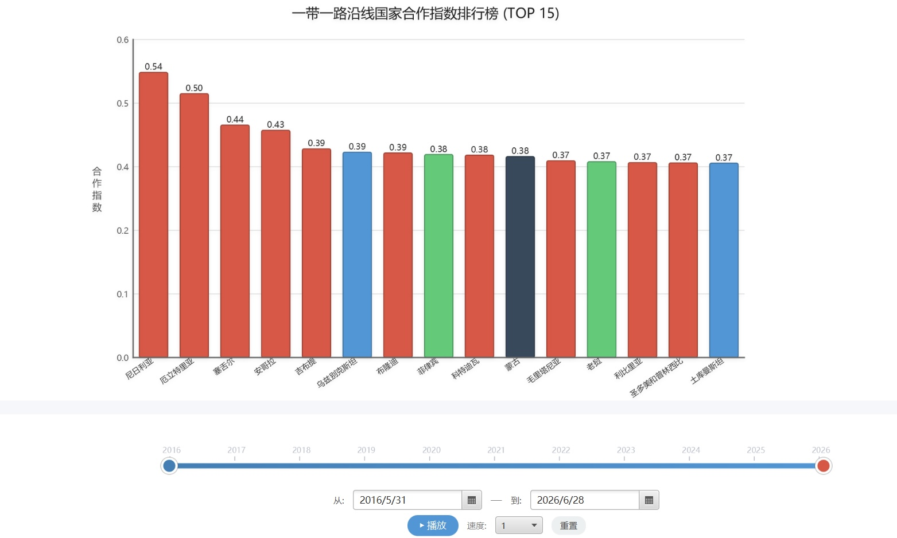
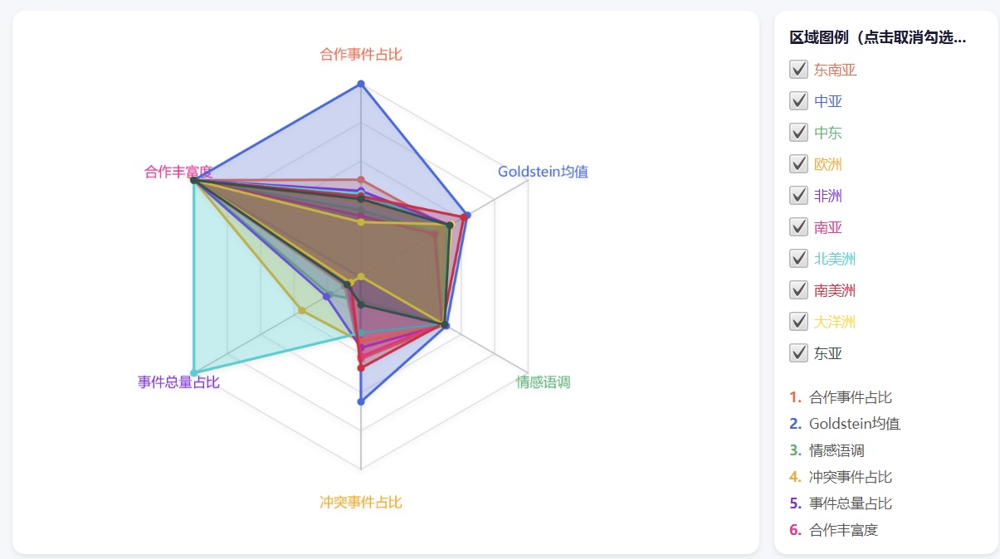
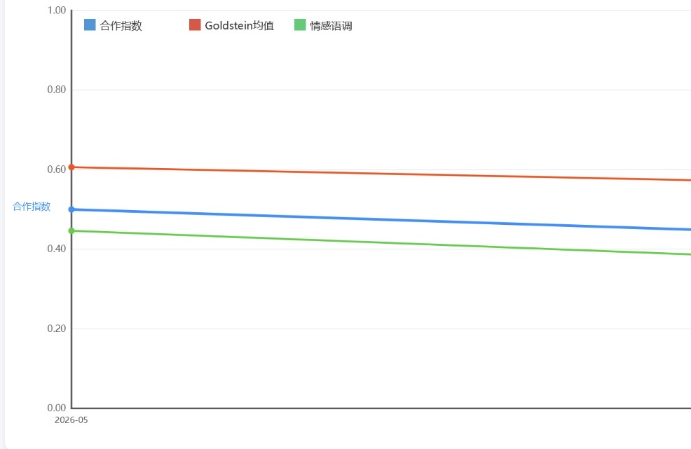
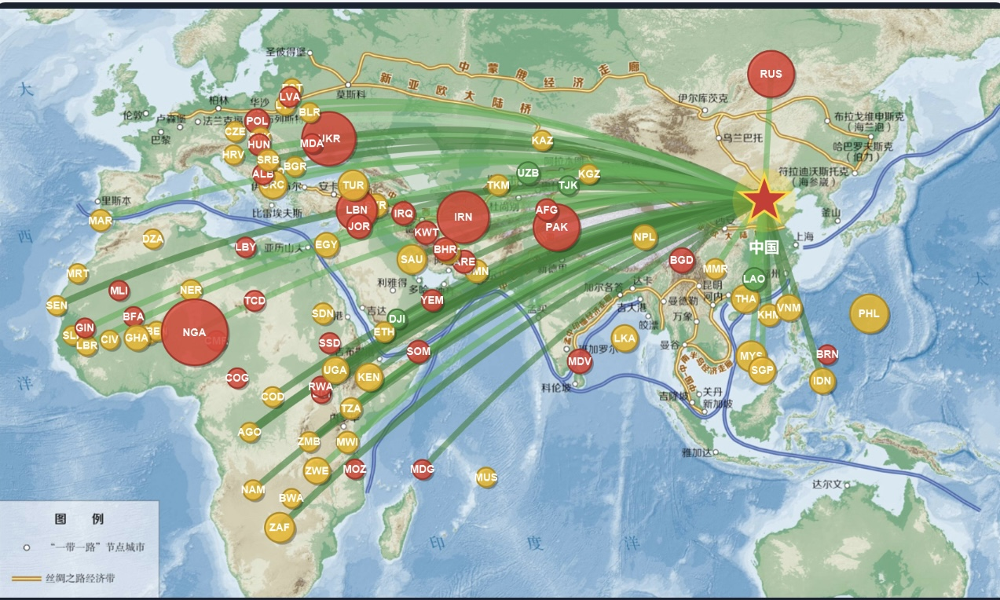

# 🌏 一带一路合作态势分析系统

> **B&R Cooperation Analysis System** — 基于 GDELT 开放数据的一带一路沿线国家合作态势量化分析与可视化平台


---

<p align="center">
  
  <br>
  <sub>专题地图：合作指数热力图 + 合作线路 + 国家排名侧栏</sub>
</p>

## 📋 目录

- [项目简介](#-项目简介)
- [界面预览](#-界面预览)
- [功能模块](#-功能模块)
- [技术栈](#-技术栈)
- [环境要求](#-环境要求)
- [快速开始](#-快速开始)
- [导入真实 GDELT 数据](#-导入真实-gdelt-数据)
- [项目结构](#-项目结构)
- [数据与指标说明](#-数据与指标说明)
- [常见问题](#-常见问题)
- [已知限制](#-已知限制)
- [许可证](#-许可证)

---

## 📖 项目简介

本系统是一个 **JavaFX 桌面应用**，以 [GDELT 2.0](https://www.gdeltproject.org/) 全球事件
数据库为数据源，对一带一路沿线国家与中国之间的合作态势做多维度量化分析与可视化。

它将 GDELT 原始事件数据（TSV，61 列）经过 **ETL → SQLite 入库 → 指标计算** 后，
用 10 个功能面板呈现合作指数、趋势、排名、区域对比、聚类分群、投资风险评估与年度报告。

- 事件数据规模：示例数据约 6 000 条（真实数据可导入数十万至数百万条）
- 覆盖国家：150+ 个一带一路沿线国家（内置中文名、经纬度、子区域）
- 数据持久化：嵌入式 SQLite（`bri.db`），带连接池与预计算索引

---

## 🖼️ 界面预览

| 指数排名 + 时间轴 | 区域雷达图 |
|---|---|
|  |  |
| 合作指数 TOP 15 柱状图、双滑块时间轴、自动播放 | 六大区域六维指标对比 |

| 趋势分析 | 专题地图（无侧栏版） |
|---|---|
|  |  |
| 合作指数 / Goldstein / 情感语调月度趋势 | 气泡大小代表事件量，颜色代表合作等级 |

---

## ✨ 功能模块

侧边栏共 **10 个功能面板**：

| 模块 | 说明 |
|------|------|
| 📊 **总览仪表盘** | 关键指标概览、合作热点 TOP5、风险预警 TOP5 |
| 📂 **数据管理** | 导入本地 GDELT 文件、按日期范围在线下载并自动解压入库、数据导出 |
| 🔍 **事件查询** | 日期 / 国家 / 事件类型 / 子区域多条件组合查询，结果饼图分布 |
| 📈 **趋势分析** | 中国与指定国家的合作指数、Goldstein 均值、情感语调月度折线 |
| 🏆 **指数排名** | 沿线国家综合合作指数柱状图 TOP N，支持区域筛选 |
| 🗺️ **专题地图** | 世界热力图 + 合作线路，气泡大小代表事件量，可交互查看国家 |
| 📡 **区域雷达图** | 东南亚 / 中亚 / 中东 / 欧洲 / 非洲 / 南亚等区域六维指标对比 |
| 🎯 **聚类与风险** | 基于 Weka 的 K-Means 国家分群 + 投资风险等级表格 |
| 🔗 **关联规则** | 基于 Apriori 挖掘国家—事件类型之间的关联规则 |
| 📄 **年度报告** | 选定国家与年份，一键生成 HTML 年度合作分析报告 |

附加能力：

- ⏱️ **时间轴控制**：底部双滑块选择时间范围，支持自动播放与关键事件标记
- 📰 **新闻动态面板**：按情感分类展示事件新闻，支持分页与详情弹窗
- 🔄 **数据变更自动刷新**：导入数据后所有面板通过观察者模式自动重载

---

## 🛠️ 技术栈

| 类别 | 技术 |
|------|------|
| 语言 | Java 23（`maven.compiler.release=23`） |
| GUI | JavaFX 23.0.1（Controls / FXML / Graphics）+ Canvas / Charts |
| 构建 | Maven 3.8+，`javafx-maven-plugin`、`maven-shade-plugin` |
| 数据库 | SQLite（`sqlite-jdbc`）+ HikariCP 连接池，WAL 模式 |
| 数据处理 | OpenCSV（GDELT TSV 解析）、Jackson（JSON 导出） |
| 分析算法 | Weka K-Means 聚类、自实现 Apriori 关联规则、加权合作指数模型 |
| 报表 | Apache POI（Excel）、HTML 报告生成 |
| 日志 | SLF4J Simple |

---

## 💻 环境要求

| 项目 | 要求 |
|------|------|
| JDK | **23 或更高版本**（推荐 25 LTS；本机验证于 25） |
| Maven | 3.8 或更高版本 |
| 操作系统 | macOS / Windows / Linux（JavaFX 本地库会按操作系统自动选择） |
| 内存 | 建议 4 GB 以上 |
| 分辨率 | 建议 1440×900 以上（窗口默认 1400×900） |

> 首次构建需要联网下载 Maven 依赖。

---

## 🚀 快速开始

```bash
# 1. 克隆
git clone https://github.com/mrryanhu-fomilail/Belt-and-Road-Cooperation-Situation-Analysis-System.git
cd Belt-and-Road-Cooperation-Situation-Analysis-System

# 2. 生成示例数据库（从 data/sample/ 导入约 6000 条事件）
make demo-db
#    如果系统没有 make，等价命令：
#    mvn -q -DskipTests compile
#    mvn -q exec:java -Dexec.mainClass=com.bri.BulkImport -Dexec.args="data/sample bri.db"

# 3. 启动程序
mvn javafx:run
#    或：make demo（数据库不存在时自动生成再启动）
```

启动后界面出现 10 个功能面板；若底部状态栏显示「已加载 N 条历史数据」表示数据就绪。

### 打包成可执行 JAR

```bash
mvn clean package
java -jar target/bri-analysis-1.0.0.jar
```

> 若 `java -jar` 报 `JavaFX runtime components are missing`，请改用 `mvn javafx:run`
> （JavaFX 建议通过模块路径启动，打包模式在不同 JDK 上行为略有差异）。

### 在 IDE 中运行

用 IntelliJ IDEA / VS Code 打开仓库根目录，等待 Maven 导入依赖，
运行入口类 `com.yourteam.bri.MainApp`。**工作目录必须是仓库根目录**，否则找不到 `bri.db`。

---

## 📥 导入真实 GDELT 数据

### 方式一：界面在线下载（需联网）

「📂 数据管理」面板 → **在线下载 GDELT 数据** → 选择日期范围 → 扫描 → 开始下载。
程序会下载 `*.export.CSV.zip`、解压、过滤非沿线国家事件并入库。

### 方式二：命令行批量导入

```bash
# 解压后的 export.CSV 放在一个目录里，整目录导入
java -cp target/bri-analysis-1.0.0.jar com.bri.BulkImport /path/to/gdelt_data bri.db
```

详细的数据格式、字段说明与示例数据来源见 [docs/DATA.md](docs/DATA.md)。

---

## 📁 项目结构

```
仓库根目录/
├── pom.xml                     # Maven 配置（JavaFX 平台自动适配）
├── Makefile                    # 常用命令：demo / run / package / clean
├── LICENSE                     # GPL-3.0
├── NOTICE.md                   # 第三方组件与素材许可说明
├── .github/workflows/build.yml # CI：三平台编译打包
├── data/sample/                # 示例 GDELT 数据（3 个文件，共约 6000 条事件）
├── docs/
│   ├── ARCHITECTURE.md         # 架构与数据流说明
│   ├── DATA.md                 # 数据格式与导入说明
│   └── screenshots/            # README 截图
└── src/
    ├── main/java/
    │   ├── com/bri/            # 后端：数据库、ETL、分析引擎、报表、CLI
    │   │   ├── config/         #   DataSource / SQLiteSchema / 国家配置
    │   │   ├── dao/            #   EventDao / CountryDao / DaoFactory
    │   │   ├── etl/            #   GDELT 解析与导入、数据导出
    │   │   ├── download/       #   GDELT 在线下载与缓存
    │   │   ├── engine/         #   合作指数、聚类、风险、关联规则
    │   │   ├── analysis/       #   分析服务
    │   │   ├── output/         #   JSON 输出
    │   │   ├── report/         #   年度报告生成
    │   │   └── BulkImport.java #   批量导入命令行工具
    │   └── com/yourteam/bri/   # 前端：JavaFX 界面与服务层
    │       ├── MainApp.java    #   程序入口
    │       ├── gui/            #   10 个功能面板 + 主窗口
    │       ├── service/        #   数据服务、引擎单例、配置服务
    │       ├── model/          #   界面数据模型
    │       └── util/           #   沿线国家基础数据
    ├── main/resources/         # 世界地图底图、国家配置 JSON
    └── test/java/com/bri/      # 烟雾测试 SmokeTest
```

---

## 📊 数据与指标说明

| 指标 | 说明 |
|------|------|
| **合作指数** | 加权综合指标 = w₁×合作事件量 + w₂×Goldstein 均值 + w₃×AvgTone + w₄×媒体关注度 |
| **Goldstein 分数** | CAMEO 事件合作—冲突量化值（-10 ~ +10，负数为冲突） |
| **AvgTone** | 新闻报道情感语调（-100 ~ +100） |
| **合作事件判定** | 依据 CAMEO 根事件码与 Goldstein 符号，判断事件属于合作或冲突 |
| **数据格式兼容** | 同时支持 GDELT 2.0 标准 61 列与旧版 58 列 `export.CSV`（自动识别列布局） |
| **风险等级** | 基于冲突事件占比、事件强度等指标分为：低 / 中 / 高 / 极高 |
| **聚类** | Weka K-Means（固定随机种子，结果可复现）对国家做多维特征分群 |

---

## ❓ 常见问题

**1. 启动后界面是空的 / 显示「已加载 0 条数据」**
数据库里没有事件。先执行 `make demo-db` 导入示例数据，或在「数据管理」面板导入文件。

**2. `mvn javafx:run` 报 JavaFX 找不到 / 模块错误**
确认 JDK ≥ 23，并使用 `mvn javafx:run`（而不是 `java -jar`）。JavaFX 由 Maven 依赖自动提供，
无需单独安装 JavaFX SDK。

**3. Windows / Linux 上编译报 `javafx-graphics` 找不到 classifier**
本项目已按操作系统自动选择 `win` / `mac` / `linux`（见 `pom.xml` 的 profiles）。
如果你手动改过 `javafx.platform` 属性，请改回由 profile 控制。

**4. 下载 GDELT 数据失败 / 很慢**
GDELT 服务器在境外，网络不稳定时可手动下载 ZIP 解压后用「导入文件」或 `BulkImport` 导入。

**5. 时间轴范围不对**
时间轴初值取自数据库中的事件日期范围；导入新数据后会自动刷新。

**6. 数据文件太大，GitHub 传不上去**
`bri.db`、下载缓存与完整数据集都已在 `.gitignore` 中排除，请勿提交。
确需共享数据时使用 Release 附件或 Git LFS。

---

## ⚠️ 已知限制

- 界面基于 Canvas 手绘地图与图表，未做高 DPI 缩放适配，4K 屏下可能偏小。
- 示例数据为 16 个 GDELT 时间片的沿线国家事件抽样（2025-11 ~ 2026-11），仅用于演示。
- 在线下载依赖 GDELT 官网可用性，且未做断点续传。
- 聚类与关联规则为课程作业级实现，未做严格参数调优。

---

## 🤝 贡献

欢迎提 Issue / PR。开发约定、提交前检查项见 [CONTRIBUTING.md](CONTRIBUTING.md)。

---

## 📄 许可证

本项目以 **GPL-3.0** 发布，见 [LICENSE](LICENSE)。

原因是运行依赖中包含 **Weka（GPL-3.0）**；如果你希望使用 MIT / Apache-2.0 等宽松许可证，
需要先移除 Weka 依赖并替换 `com.bri.engine.WekaClusteringStrategy`。详见 [NOTICE.md](NOTICE.md)。

数据来源：GDELT 2.0（The GDELT Project）。
